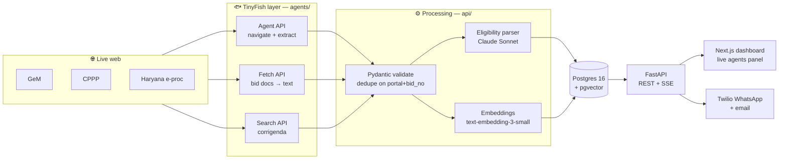

<div align="center">

# 🦅 TenderHawk

**AI web agents that find the Indian government tenders a small business can actually win, and tell it why.**

Built on [TinyFish](https://tinyfish.ai) · HackIIITD 2026 · Team **L.C Hard**, JIIT Noida

`ELIGIBLE` 🟢 &nbsp;·&nbsp; `CHECK_DOCS` 🟠 &nbsp;·&nbsp; `NOT_ELIGIBLE` 🔴

</div>

---

## The problem

Government procurement is one of the biggest markets an Indian small business can sell into, and one of the hardest to read.

- **₹5 lakh crore** went through GeM in FY 2025–26, and **25%** of central procurement is reserved for MSEs by policy.
- **11 lakh+ MSEs** are registered on GeM, yet tenders are scattered across GeM, CPPP, IREPS, defence and ~30 state portals, each with its own UI, filters and captchas.
- Eligibility rules (turnover, past experience, EMD, certifications) are buried in long bid PDFs.
- Deadlines are hard, and corrigenda that extend dates or change terms are posted quietly.

So owners check portals late at night, or pay consultants **₹5–20k a month** to do it for them.

## What TenderHawk does

| | Step | How |
|---|---|---|
| 1 | **Profile once** | Products, HSN codes, turnover, certifications (Udyam, Startup India, ISO), states served |
| 2 | **Agents sweep portals** | TinyFish agents open each portal, search, filter, paginate and return bids as validated JSON |
| 3 | **Read & match** | Bid documents become text; an LLM pulls out every eligibility criterion **with the exact source clause**; rules check hard criteria; embeddings rank product fit |
| 4 | **Alert & act** | WhatsApp / email with the tender, value, deadline, verdict, reasons and document checklist |

> **Supply of steel storage racks** · MoD · ₹18.5 L · closes 28 Oct
> 🟢 **Eligible:** turnover met, MSE EMD exemption applies
> 🟠 **Check:** needs 3 years of past-supply proof

**Why it's different:** it reads eligibility, not keywords; one profile covers every portal; and every verdict links to the clause it came from.

## Architecture



**One rule holds the design together:** TinyFish is the only component that touches the live web. Everything downstream works on validated JSON, which is also why the whole demo can replay offline.

| TinyFish API | Used for | When |
|---|---|---|
| **Agent** | Opens a portal, searches, paginates, extracts bids (streamed step by step to the UI) | Listing sweeps only, never per user |
| **Fetch** | Renders a bid page or document to clean text for the LLM | Once per new bid |
| **Search** | Finds corrigenda, deadline extensions, buyer context | Daily per active bid |

## Status

This is a 24-hour hackathon build. What exists right now:

- [x] **Agents layer** (`agents/`): TinyFish wrapper, schemas, goals for GeM / CPPP / Haryana, CLI, fixture recorder, offline replay
- [x] First live GeM run recorded to `delivery/fixtures/`
- [ ] FastAPI backend, Postgres models, eligibility parser, matcher (`api/`)
- [ ] Next.js dashboard with live agents panel (`web/`)
- [ ] WhatsApp / email alerts, Docker Compose (`delivery/`)

The build order and interfaces are in [`PLAN.md`](PLAN.md).

## Quickstart

Requires Python 3.11+ and a [TinyFish API key](https://tinyfish.ai).

```bash
git clone https://github.com/siddhant1729/Tenderhawk.git
cd Tenderhawk
python -m venv .venv && source .venv/bin/activate
pip install -r requirements.txt
cp .env.example .env        # then fill in TINYFISH_API_KEY
```

**Sweep a portal live** (uses TinyFish credits, takes 1–3 minutes):

```bash
python -m agents.cli gem "storage rack"
```

```
[gem:started:0] Opening https://bidplus.gem.gov.in/all-bids
[gem:step:1] Navigate to GeM bid list page
[gem:step:2] Enter search keyword ...
...
[gem:result:8] Found 10 bids (10)
{"portal":"gem","bid_no":"GEM/2026/B/...","title":"...","end_date":"2026-...+05:30", ...}
```

**Record a run as a fixture** (also fetches the bid documents):

```bash
python -m agents.cli gem "storage rack" --record
```

**Replay offline**: no network, no credits, same step events:

```bash
FALLBACK_MODE=true python -m agents.cli gem "storage rack"
```

### Environment

| Variable | Purpose |
|---|---|
| `TINYFISH_API_KEY` | TinyFish Agent / Fetch / Search |
| `FALLBACK_MODE` | `true` replays `delivery/fixtures/*.json` instead of live runs |
| `ANTHROPIC_API_KEY`, `LLM_MODEL`, `LLM_MODEL_FAST` | Eligibility parser (`claude-sonnet-5-5`) and light tasks (`claude-haiku-5-5`) |
| `OPENAI_API_KEY`, `EMBEDDING_MODEL`, `EMBEDDING_DIM` | `text-embedding-3-small`, 1536 dims |
| `DATABASE_URL`, `REDIS_URL` | Postgres + pgvector, Redis pub/sub for SSE |
| `TWILIO_*`, `ALERT_WHATSAPP_TO`, `SMTP_URL` | Alerts |

See [`.env.example`](.env.example). Never commit `.env`.

## Repo layout

```
agents/      TinyFish wrapper, portal goals, schemas, SSE step events
api/         FastAPI app, models, migrations, eligibility parser, matcher
web/         Next.js dashboard: profile form, live agents panel, matches
delivery/    Alerts, seed profiles, fixtures, fallback mode, Docker
```

## Ground rules

- 🚫 **Never bypass a captcha.** A blocked portal is skipped and the user gets a direct link.
- 👀 **Read-only.** TenderHawk never submits or participates in a bid.
- 🇮🇳 Agent runs go through an Indian proxy, because government portals drop connections from foreign IPs.
- 🔑 Config comes from env vars only; secrets never enter the repo.

## Who it's for

| Plan | For | Price |
|---|---|---|
| Free | One category, weekly digest | ₹0 |
| Pro | All categories, daily alerts | ₹999 / month |
| Consultant | CA firms and tender consultants, 25 clients | ₹4,999 / month |

Channels: MSMEs and startups directly, CA firms and tender consultants, incubators and MSME associations.

## Team

| | Area |
|---|---|
| **Siddhant** (lead) | TinyFish agents, schemas, step events |
| **Harsh** | Backend, eligibility parser, matcher |
| **Aditya** | Next.js dashboard |
| **Vandan** | Alerts, fixtures, fallback mode, Docker |

<div align="center">
<sub>Built in 24 hours at HackIIITD 2026, IIIT Delhi.</sub>
</div>
