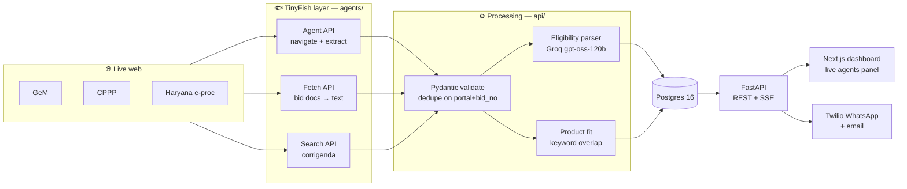

<div align="center">

# 🦅 TenderHawk

**AI web agents that find the Indian government tenders a small business can actually win, and tell it why.**

Built on [TinyFish](https://tinyfish.ai) · HackIIITD 2026 · Team **L.C Hard**, JIIT Noida

`ELIGIBLE` 🟢 &nbsp;·&nbsp; `CHECK_DOCS` 🟠 &nbsp;·&nbsp; `NOT_ELIGIBLE` 🔴

</div>

---

## The problem

Government procurement is one of the biggest markets an Indian small business can sell into, and one of the hardest to read.

- **₹5 lakh crore** went through GeM in FY 2025–26, and **25%** of central procurement is reserved for MSEs by policy.
- **11 lakh+ MSEs** are registered on GeM, yet tenders are scattered across GeM, CPPP, IREPS, defence and ~30 state portals, each with its own UI, filters and captchas.
- Eligibility rules (turnover, past experience, EMD, certifications) are buried in long bid PDFs.
- Deadlines are hard, and corrigenda that extend dates or change terms are posted quietly.

So owners check portals late at night, or pay consultants **₹5–20k a month** to do it for them.

## What TenderHawk does

| | Step | How |
|---|---|---|
| 1 | **Profile once** | Products, HSN codes, turnover, certifications (Udyam, Startup India, ISO), states served |
| 2 | **Agents sweep portals** | TinyFish agents open each portal, search, filter, paginate and return bids as validated JSON |
| 3 | **Read & match** | Bid documents become text; an LLM pulls out every eligibility criterion **with the exact source clause**; rules check hard criteria; keyword overlap ranks product fit |
| 4 | **Alert & act** | WhatsApp / email with the tender, value, deadline, verdict, reasons and document checklist |

> **Supply of steel storage racks** · MoD · ₹18.5 L · closes 28 Oct
> 🟢 **Eligible:** turnover met, MSE EMD exemption applies
> 🟠 **Check:** needs 3 years of past-supply proof

**Why it's different:** it reads eligibility, not keywords; one profile covers every portal; and every verdict links to the clause it came from.

## Architecture



**One rule holds the design together:** TinyFish is the only component that navigates portals; bid PDFs it finds are downloaded via an Indian connection. Both happen only in `agents/` (GeM PDFs: TinyFish Fetch has no Indian proxy and a TinyFish agent can't read a PDF, so `agents/` downloads the file itself). Everything downstream works on validated JSON, which is also why the whole demo can replay offline.

| TinyFish API | Used for | When |
|---|---|---|
| **Agent** | Opens a portal, searches, paginates, extracts bids (streamed step by step to the UI) | Listing sweeps only, never per user |
| **Fetch** | Renders a bid page or document to clean text for the LLM (GeM PDFs fail with `proxy_error`; `agents/` then downloads the PDF itself) | Once per new bid, reused by `doc_url` afterwards |
| **Search** | Finds corrigenda, deadline extensions, buyer context | Daily per active bid |

## Status

This is a 24-hour hackathon build. What exists right now:

- [x] **Agents layer** (`agents/`): TinyFish wrapper, schemas, goals for GeM / CPPP / Haryana, CLI, fixture recorder, offline replay
- [x] **Backend** (`api/`): FastAPI, Postgres models + migrations, background sweeps with live SSE, eligibility parser on Groq's free tier (`openai/gpt-oss-120b`, strict JSON schema), rules matcher with keyword-overlap ranking and clause excerpts, parse cache + background parsing, daily corrigenda job, one demo clock (`DEMO_NOW`)
- [x] **Dashboard** (`web/`): Next.js 16, built from the Google Stitch "TenderHawk" design — landing page, onboarding, and per-profile tabs (Live Matches, Watched Portals, Business Profile, WhatsApp Alerts) that share one live sweep over SSE; match detail with the source clause highlighted in the bid text. Only real data is shown (no mockup claims)
- [x] **Alerts** (`delivery/alerts.py`): WhatsApp via the Twilio sandbox and email via SMTP; `POST /matches/{id}/alert`; new eligible matches are alerted after each sweep
- [x] **Infra** (`delivery/`): Docker Compose for Postgres and Redis (plus API and dashboard images), Ramesh seed profile, fixture builder
- [x] **Real fixtures**: GeM storage rack (parsed, ELIGIBLE), CPPP storage rack (3 bids, no readable documents), Haryana (captcha: replays as the blocked card), GeM steel almirah (8 bids). Real verdict mix: 1 ELIGIBLE, 11 CHECK_DOCS, 0 NOT_ELIGIBLE
- [x] **Live document text for GeM**: Fetch, else a direct PDF download in `agents/`
- [x] **Preflight + clean state**: `python scripts/preflight.py`, `python -m delivery.seed --reset`
- [x] **Run on the real stack** (2026-10-25, Docker up, replay mode): sweep → 12 tenders, 4 agent cards, verdicts and clauses on every page; 116 + 22 tests pass
- [ ] **Live sweeps returning bids**: agent runs now queue 2 at a time and are cut off and cancelled at 300 s; GeM is reachable but its goal still returns 0 bids (closing-soonest sort, see PLAN.md C5); CPPP's listing pages now need a captcha, so only its homepage list is readable. Demo with `FALLBACK_MODE=true` until then
- [ ] **Twilio stage phone**: credentials set and verified; the phone still has to join the sandbox and receive one real alert. Then a hand click-through of "Sweep now" / "Send now" in a browser (see PLAN.md §9)

The build order and interfaces are in [`PLAN.md`](PLAN.md).

## Quickstart

Requires Python 3.11+, Docker, a [TinyFish API key](https://tinyfish.ai) and a free [Groq API key](https://console.groq.com). No Anthropic or OpenAI key is needed.

```bash
git clone https://github.com/siddhant1729/Tenderhawk.git
cd Tenderhawk
python -m venv .venv && source .venv/bin/activate
pip install -r requirements.txt
cp .env.example .env        # then fill in the keys
```

### Run the API

```bash
docker compose up -d              # Postgres 16, Redis
alembic upgrade head
python -m delivery.seed           # creates Ramesh's profile, prints its id (--reset: clean demo state first)
uvicorn api.main:app --reload     # http://localhost:8000
```

```bash
curl localhost:8000/health
curl -X POST localhost:8000/sweeps -H 'content-type: application/json' -d '{"profile_id": <id>}'
curl -N localhost:8000/sweeps/<sweep_id>/events      # live agent steps (SSE)
curl localhost:8000/profiles/<id>/matches            # relevant first, then verdict, then fit
```

Set `FALLBACK_MODE=true` to run the whole sweep from recorded fixtures: no network and no credits. Deadlines then run on a frozen clock (`DEMO_NOW`, else the newest fixture's `recorded_at`), so recorded bids never expire.

### Run the dashboard

```bash
cd web && npm install && npm run dev      # http://localhost:3000 (talks to NEXT_PUBLIC_API_URL)
```

| Route | Page |
|---|---|
| `/` | Landing page (problem, how it works, pricing — pitch only) |
| `/start` | Create a business profile (or open an existing one) |
| `/profiles/{id}` | **Live Matches**: Sweep now, live agent cards, verdict filters, a card per tender with reasons and the quoted bid clause |
| `/profiles/{id}/portals` | **Watched Portals**: one live card per TinyFish agent (GeM, CPPP, Haryana, corrigenda), what they search for |
| `/profiles/{id}/profile` | **Business Profile**: the profile's facts, what each certification changes in matching, the latest verdict |
| `/profiles/{id}/alerts` | **WhatsApp Alerts**: the exact alert text per match, Send now, which channels are set up |
| `/matches/{id}` | Verdict, highlighted source clause, document checklist, alert button |

`/profiles/{id}?sweep=<sweep_id>` follows a sweep that's already running (the API replays its log). Fonts are bundled
at build time and icons are inline, so the dashboard works offline.

Or run everything in Docker: `docker compose --profile app up -d --build` starts Postgres, Redis, the API on :8000
and the dashboard on :3000 (move a busy host port with e.g. `REDIS_PORT=6380`). A single-page fallback console is
also served by the API at `/demo`.

Before a demo (checklist at the end of [`PLAN.md`](PLAN.md)):

```bash
python -m delivery.seed --reset   # wipe tenders, matches, alert flags and sweep logs; reseed Ramesh
python scripts/preflight.py       # PASS/WARN/FAIL for the whole stack; must end in READY
```

Twilio trial accounts prefix outgoing SMS with "Sent from your Twilio trial account -"; whether the WhatsApp sandbox does too isn't confirmed, so check the first real send (the message still leads with the verdict either way). The stage phone must have sent the sandbox join message within 24 h.

| Method | Path | What it does |
|---|---|---|
| `GET` | `/health` | DB, Redis, fallback mode, next corrigenda check |
| `POST` | `/profiles` · `GET /profiles/{id}` | Create / read a business profile |
| `POST` | `/sweeps` | Start a sweep in the background → `sweep_id` |
| `GET` | `/sweeps/{id}/events` | SSE stream of agent steps (late clients get the full log) |
| `GET` | `/profiles/{id}/matches` | Matches with verdict and fit score |
| `GET` | `/matches/{id}` | Tender, eligibility with source clauses, reasons, missing docs, corrigenda |
| `POST` | `/profiles/{id}/match` | Re-run the matcher without sweeping |
| `POST` | `/corrigenda/check` | Run the corrigenda job now (Search API, no credits) |
| `POST` | `/matches/{id}/alert` | Send the WhatsApp / email alert now; returns per-channel status and the message preview |
| `GET` | `/matches/{id}/alert/preview` | The alert text, without sending |
| `GET` | `/alerts/status` | Which channels are configured (WhatsApp / email), masked recipient, auto-alert limit |

### Run the tests

```bash
python -m pytest -q tests          # 117 tests, no API keys needed (a few need Postgres/Redis running)
cd web && npm test                 # 22 tests: dashboard helpers and live-panel state
```

### Drive the agents directly

**Sweep a portal live** (uses TinyFish credits, takes 1–3 minutes):

```bash
python -m agents.cli gem "storage rack"
```

```
[gem:started:0] Opening https://bidplus.gem.gov.in/all-bids
[gem:step:1] Navigate to GeM bid list page
[gem:step:2] Enter search keyword ...
...
[gem:result:8] Found 10 bids (10)
{"portal":"gem","bid_no":"GEM/2026/B/...","title":"...","end_date":"2026-...+05:30", ...}
```

**Record a run as a fixture** (also fetches the bid documents):

```bash
python -m agents.cli gem "storage rack" --record
```

**Attach bid documents and parses** (TinyFish Fetch can't reach GeM PDFs yet, so save them from a browser,
named by the number at the end of the bid's document link, e.g. `9988944.pdf`):

```bash
python -m delivery.build_fixture attach gem "storage rack" --docs ~/Downloads/gem_bids --parse
python -m delivery.build_fixture check gem "storage rack"      # warns about closed bids, missing docs or parses
```

**Replay offline**: no network, no credits, same step events:

```bash
FALLBACK_MODE=true python -m agents.cli gem "storage rack"
```

### Environment

| Variable | Purpose |
|---|---|
| `TINYFISH_API_KEY` | TinyFish Agent / Fetch / Search |
| `FALLBACK_MODE` | `true` replays `delivery/fixtures/*.json` instead of live runs |
| `DEMO_NOW` | Fallback only: the frozen "now" for deadlines (ISO, IST if no offset). Empty = the newest fixture's `recorded_at`, so recorded bids never expire |
| `GROQ_API_KEY`, `LLM_MODEL`, `LLM_MODEL_FAST` | Eligibility parser on Groq's free tier (`openai/gpt-oss-120b`, strict JSON schema) and light tasks (`openai/gpt-oss-20b`) |
| `OPENAI_API_KEY` | Not needed. Product fit is keyword overlap; `api/embeddings.py` would switch to OpenAI embeddings only if a key were set |
| `LLM_EFFORT`, `LLM_MAX_DOC_CHARS`, `LLM_CONCURRENCY` | Parser reasoning effort; characters sent per document and documents parsed at once (free tier: 8k tokens/min) |
| `DATABASE_URL`, `REDIS_URL` | Postgres + pgvector, Redis pub/sub for SSE |
| `LIVE_MAX_KEYWORDS` | Profile keywords per live portal (each is a billed agent run); replayed portals use all keywords |
| `LIVE_PORTALS` | With `FALLBACK_MODE=false`: portals swept live (e.g. `gem`); the others replay their recorded runs, labelled as recordings. Empty = all live |
| `TINYFISH_CONCURRENCY`, `AGENT_TIMEOUT` | Agent runs at once (the plan allows 2; extra runs wait locally, GeM first) and the hard cap per run in seconds (default 480: live GeM runs take 300–512 s; the run is cancelled on TinyFish) |
| `SCHEDULER_ENABLED`, `CORRIGENDA_HOUR` | Daily corrigenda job (07:00 IST by default) |
| `NEXT_PUBLIC_API_URL` | Where the dashboard calls the API (baked into the web build: rebuild after changing it) |
| `WEB_ORIGINS` | Browser origins the API allows (CORS), comma-separated; default `http://localhost:3000,http://127.0.0.1:3000`. Add the laptop's LAN address if the dashboard is opened from another device |
| `WEB_URL` | Where `scripts/preflight.py` expects the dashboard |
| `TWILIO_*`, `ALERT_WHATSAPP_TO` | WhatsApp alerts (Twilio sandbox; `ALERT_WHATSAPP_TO` = the stage phone) |
| `SMTP_URL`, `ALERT_EMAIL_FROM`, `ALERT_EMAIL_TO` | Email alerts |
| `AUTO_ALERT` | Alert new relevant ELIGIBLE matches after each sweep (max 3 per sweep) |
| `NEXT_PUBLIC_API_URL` | API address for the dashboard (copy `web/.env.example` to `web/.env.local`) |

See [`.env.example`](.env.example). Never commit `.env`.

## Repo layout

```
agents/      TinyFish wrapper, portal goals, schemas, SSE step events
api/         FastAPI app, models, migrations, eligibility parser, matcher, corrigenda job
web/         Next.js dashboard (Stitch design): landing, onboarding, Live Matches, Watched Portals, Business Profile, WhatsApp Alerts, match detail
delivery/    Alerts (WhatsApp, email), seed profile, fixtures and the fixture builder, Docker images
tests/       pytest suite for sweeps, eligibility, matcher, corrigenda
```

## Ground rules

- 🚫 **Never bypass a captcha.** A blocked portal is skipped and the user gets a direct link.
- 👀 **Read-only.** TenderHawk never submits or participates in a bid.
- 🇮🇳 Agent runs go through an Indian proxy, because government portals drop connections from foreign IPs.
- ⏱️ At most 2 agents run at once (the plan's limit; GeM starts first, the rest wait locally, not in TinyFish's queue), and each run is cut off at 300 s and cancelled on TinyFish (its own 300 s cap is soft), so a stuck portal becomes an error card with a direct link, not a sweep that never ends or keeps billing.
- 🔑 Config comes from env vars only; secrets never enter the repo.

## Who it's for

| Plan | For | Price |
|---|---|---|
| Free | One category, weekly digest | ₹0 |
| Pro | All categories, daily alerts | ₹999 / month |
| Consultant | CA firms and tender consultants, 25 clients | ₹4,999 / month |

Channels: MSMEs and startups directly, CA firms and tender consultants, incubators and MSME associations.

## Team

| | Area |
|---|---|
| **Siddhant** (lead) | TinyFish agents, schemas, step events |
| **Harsh** | Backend, eligibility parser, matcher |
| **Aditya** | Next.js dashboard |
| **Vandan** | Alerts, fixtures, fallback mode, Docker |

<div align="center">
<sub>Built in 24 hours at HackIIITD 2026, IIIT Delhi.</sub>
</div>
