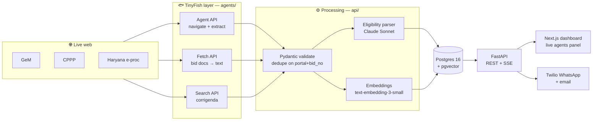

<div align="center">

# 🦅 TenderHawk

**AI web agents that find the Indian government tenders a small business can actually win, and tell it why.**

Built on [TinyFish](https://tinyfish.ai) · HackIIITD 2026 · Team **L.C Hard**, JIIT Noida

`ELIGIBLE` 🟢 &nbsp;·&nbsp; `CHECK_DOCS` 🟠 &nbsp;·&nbsp; `NOT_ELIGIBLE` 🔴

</div>

---

## The problem

Government procurement is one of the biggest markets an Indian small business can sell into, and one of the hardest to read.

- **₹5 lakh crore** went through GeM in FY 2025–26, and **25%** of central procurement is reserved for MSEs by policy.
- **11 lakh+ MSEs** are registered on GeM, yet tenders are scattered across GeM, CPPP, IREPS, defence and ~30 state portals, each with its own UI, filters and captchas.
- Eligibility rules (turnover, past experience, EMD, certifications) are buried in long bid PDFs.
- Deadlines are hard, and corrigenda that extend dates or change terms are posted quietly.

So owners check portals late at night, or pay consultants **₹5–20k a month** to do it for them.

## What TenderHawk does

| | Step | How |
|---|---|---|
| 1 | **Profile once** | Products, HSN codes, turnover, certifications (Udyam, Startup India, ISO), states served |
| 2 | **Agents sweep portals** | TinyFish agents open each portal, search, filter, paginate and return bids as validated JSON |
| 3 | **Read & match** | Bid documents become text; an LLM pulls out every eligibility criterion **with the exact source clause**; rules check hard criteria; embeddings rank product fit |
| 4 | **Alert & act** | WhatsApp / email with the tender, value, deadline, verdict, reasons and document checklist |

> **Supply of steel storage racks** · MoD · ₹18.5 L · closes 28 Oct
> 🟢 **Eligible:** turnover met, MSE EMD exemption applies
> 🟠 **Check:** needs 3 years of past-supply proof

**Why it's different:** it reads eligibility, not keywords; one profile covers every portal; and every verdict links to the clause it came from.

## Architecture



**One rule holds the design together:** TinyFish is the only component that navigates portals; bid PDFs it finds are downloaded via an Indian connection. Both happen only in `agents/` (GeM PDFs: TinyFish Fetch has no Indian proxy and a TinyFish agent can't read a PDF, so `agents/` downloads the file itself). Everything downstream works on validated JSON, which is also why the whole demo can replay offline.

| TinyFish API | Used for | When |
|---|---|---|
| **Agent** | Opens a portal, searches, paginates, extracts bids (streamed step by step to the UI) | Listing sweeps only, never per user |
| **Fetch** | Renders a bid page or document to clean text for the LLM (GeM PDFs currently fail with `proxy_error`; saved PDFs are attached instead) | Once per new bid |
| **Search** | Finds corrigenda, deadline extensions, buyer context | Daily per active bid |

## Status

This is a 24-hour hackathon build. What exists right now:

- [x] **Agents layer** (`agents/`): TinyFish wrapper, schemas, goals for GeM / CPPP / Haryana, CLI, fixture recorder, offline replay
- [x] **Backend** (`api/`): FastAPI, Postgres models + migrations, background sweeps with live SSE, Claude eligibility parser, matcher with embeddings and clause excerpts, daily corrigenda job (61 backend tests, 14 dashboard tests)
- [x] **Dashboard** (`web/`): Next.js 16 — profile form, live agents panel (4 cards over SSE), matches with verdict chips, match detail with the source clause highlighted in the bid text, alert button
- [x] **Alerts** (`delivery/alerts.py`): WhatsApp via the Twilio sandbox and email via SMTP; `POST /matches/{id}/alert`; new eligible matches are alerted after each sweep
- [x] **Infra** (`delivery/`): Docker Compose for Postgres + pgvector and Redis (plus API and dashboard images), Ramesh seed profile, fixture builder
- [ ] **Demo-ready fixtures**: the first GeM recording holds unrelated, closed bids. Re-record "storage rack" and attach bid documents (see below); needs `TINYFISH_API_KEY` and `GROQ_API_KEY`
- [ ] **Live document text for GeM**: TinyFish Fetch gets `proxy_error` on GeM bid PDFs, so live sweeps have no document text yet (saved PDFs work)

The build order and interfaces are in [`PLAN.md`](PLAN.md).

## Quickstart

Requires Python 3.11+, Docker, and a [TinyFish API key](https://tinyfish.ai).

```bash
git clone https://github.com/siddhant1729/Tenderhawk.git
cd Tenderhawk
python -m venv .venv && source .venv/bin/activate
pip install -r requirements.txt
cp .env.example .env        # then fill in the keys
```

### Run the API

```bash
docker compose up -d              # Postgres 16 + pgvector, Redis
alembic upgrade head
python -m delivery.seed           # creates Ramesh's profile, prints its id (--reset: clean demo state first)
uvicorn api.main:app --reload     # http://localhost:8000
```

```bash
curl localhost:8000/health
curl -X POST localhost:8000/sweeps -H 'content-type: application/json' -d '{"profile_id": <id>}'
curl -N localhost:8000/sweeps/<sweep_id>/events      # live agent steps (SSE)
curl localhost:8000/profiles/<id>/matches            # relevant first, then verdict, then fit
```

Set `FALLBACK_MODE=true` to run the whole sweep from recorded fixtures: no network and no credits.

### Run the dashboard

```bash
cd web && npm install && npm run dev      # http://localhost:3000 (talks to NEXT_PUBLIC_API_URL)
```

Or run everything in Docker: `docker compose --profile app up -d --build` starts Postgres, Redis, the API on :8000
and the dashboard on :3000 (move a busy host port with e.g. `REDIS_PORT=6380`). A single-page fallback console is
also served by the API at `/demo`.

Before a demo, run through the checklist at the end of [`PLAN.md`](PLAN.md): fixtures pass
`python -m delivery.build_fixture check`, the stage phone has joined the Twilio sandbox in the last 24 h, and
`python -m delivery.alerts reset` clears rehearsal alerts so the on-stage sweep alerts again; `python -m delivery.seed --reset` wipes all demo state (tenders, matches, alert flags, sweep logs) and reseeds Ramesh. Before the demo, `python scripts/preflight.py` checks the whole stack and must print `READY`.

| Method | Path | What it does |
|---|---|---|
| `GET` | `/health` | DB, Redis, fallback mode, next corrigenda check |
| `POST` | `/profiles` · `GET /profiles/{id}` | Create / read a business profile |
| `POST` | `/sweeps` | Start a sweep in the background → `sweep_id` |
| `GET` | `/sweeps/{id}/events` | SSE stream of agent steps (late clients get the full log) |
| `GET` | `/profiles/{id}/matches` | Matches with verdict and fit score |
| `GET` | `/matches/{id}` | Tender, eligibility with source clauses, reasons, missing docs, corrigenda |
| `POST` | `/profiles/{id}/match` | Re-run the matcher without sweeping |
| `POST` | `/corrigenda/check` | Run the corrigenda job now (Search API, no credits) |
| `POST` | `/matches/{id}/alert` | Send the WhatsApp / email alert now; returns per-channel status and the message preview |

### Run the tests

```bash
python -m pytest -q tests          # no API keys needed
cd web && npm test                 # dashboard helpers and live-panel state
```

### Drive the agents directly

**Sweep a portal live** (uses TinyFish credits, takes 1–3 minutes):

```bash
python -m agents.cli gem "storage rack"
```

```
[gem:started:0] Opening https://bidplus.gem.gov.in/all-bids
[gem:step:1] Navigate to GeM bid list page
[gem:step:2] Enter search keyword ...
...
[gem:result:8] Found 10 bids (10)
{"portal":"gem","bid_no":"GEM/2026/B/...","title":"...","end_date":"2026-...+05:30", ...}
```

**Record a run as a fixture** (also fetches the bid documents):

```bash
python -m agents.cli gem "storage rack" --record
```

**Attach bid documents and parses** (TinyFish Fetch can't reach GeM PDFs yet, so save them from a browser,
named by the number at the end of the bid's document link, e.g. `9988944.pdf`):

```bash
python -m delivery.build_fixture attach gem "storage rack" --docs ~/Downloads/gem_bids --parse
python -m delivery.build_fixture check gem "storage rack"      # warns about closed bids, missing docs or parses
```

**Replay offline**: no network, no credits, same step events:

```bash
FALLBACK_MODE=true python -m agents.cli gem "storage rack"
```

### Environment

| Variable | Purpose |
|---|---|
| `TINYFISH_API_KEY` | TinyFish Agent / Fetch / Search |
| `FALLBACK_MODE` | `true` replays `delivery/fixtures/*.json` instead of live runs |
| `DEMO_NOW` | Fallback only: the frozen "now" for deadlines (ISO, IST if no offset). Empty = the newest fixture's `recorded_at`, so recorded bids never expire |
| `GROQ_API_KEY`, `LLM_MODEL`, `LLM_MODEL_FAST` | Eligibility parser on Groq's free tier (`openai/gpt-oss-120b`, strict JSON schema) and light tasks (`openai/gpt-oss-20b`) |
| `OPENAI_API_KEY`, `EMBEDDING_MODEL`, `EMBEDDING_DIM` | Optional `text-embedding-3-small`, 1536 dims; without a key, ranking uses keyword overlap |
| `LLM_EFFORT`, `LLM_MAX_DOC_CHARS`, `LLM_CONCURRENCY` | Parser reasoning effort; characters sent per document and documents parsed at once (free tier: 8k tokens/min) |
| `DATABASE_URL`, `REDIS_URL` | Postgres + pgvector, Redis pub/sub for SSE |
| `LIVE_MAX_KEYWORDS` | Profile keywords per live sweep (each is a billed agent run per portal) |
| `SCHEDULER_ENABLED`, `CORRIGENDA_HOUR` | Daily corrigenda job (07:00 IST by default) |
| `TWILIO_*`, `ALERT_WHATSAPP_TO` | WhatsApp alerts (Twilio sandbox; `ALERT_WHATSAPP_TO` = the stage phone) |
| `SMTP_URL`, `ALERT_EMAIL_FROM`, `ALERT_EMAIL_TO` | Email alerts |
| `AUTO_ALERT` | Alert new relevant ELIGIBLE matches after each sweep (max 3 per sweep) |
| `NEXT_PUBLIC_API_URL` | API address for the dashboard (copy `web/.env.example` to `web/.env.local`) |

See [`.env.example`](.env.example). Never commit `.env`.

## Repo layout

```
agents/      TinyFish wrapper, portal goals, schemas, SSE step events
api/         FastAPI app, models, migrations, eligibility parser, matcher, corrigenda job
web/         Next.js dashboard: profile form, live agents panel, matches, match detail
delivery/    Alerts (WhatsApp, email), seed profile, fixtures and the fixture builder, Docker images
tests/       pytest suite for sweeps, eligibility, matcher, corrigenda
```

## Ground rules

- 🚫 **Never bypass a captcha.** A blocked portal is skipped and the user gets a direct link.
- 👀 **Read-only.** TenderHawk never submits or participates in a bid.
- 🇮🇳 Agent runs go through an Indian proxy, because government portals drop connections from foreign IPs.
- ⏱️ Agent runs are capped at 30 steps / 300 s, so a stuck portal becomes an error card with a direct link, not a sweep that never ends.
- 🔑 Config comes from env vars only; secrets never enter the repo.

## Who it's for

| Plan | For | Price |
|---|---|---|
| Free | One category, weekly digest | ₹0 |
| Pro | All categories, daily alerts | ₹999 / month |
| Consultant | CA firms and tender consultants, 25 clients | ₹4,999 / month |

Channels: MSMEs and startups directly, CA firms and tender consultants, incubators and MSME associations.

## Team

| | Area |
|---|---|
| **Siddhant** (lead) | TinyFish agents, schemas, step events |
| **Harsh** | Backend, eligibility parser, matcher |
| **Aditya** | Next.js dashboard |
| **Vandan** | Alerts, fixtures, fallback mode, Docker |

<div align="center">
<sub>Built in 24 hours at HackIIITD 2026, IIIT Delhi.</sub>
</div>
